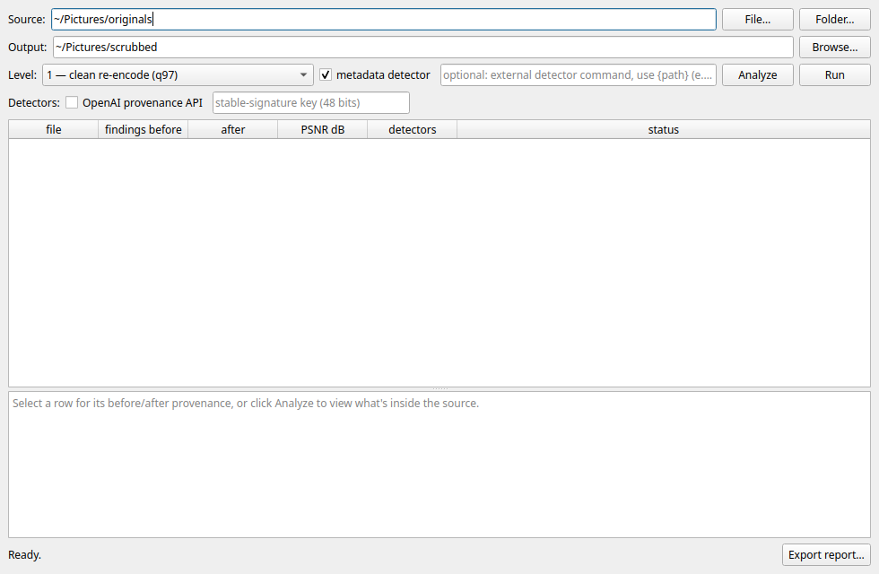
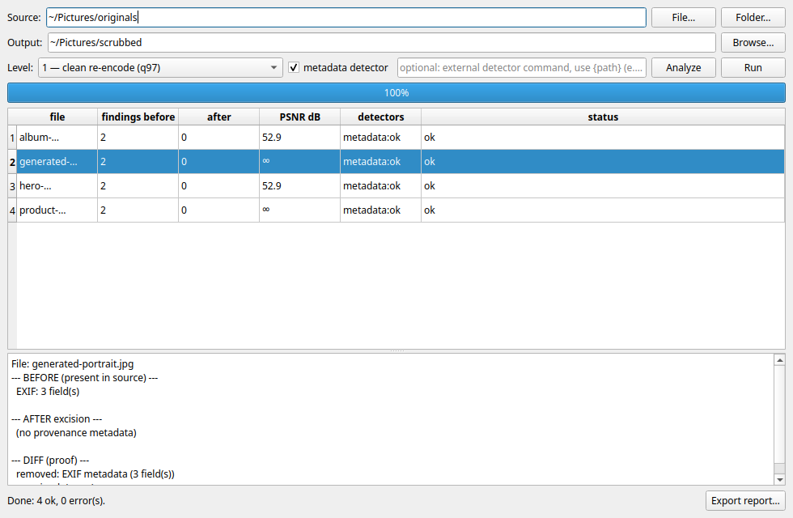

# Provenance Scrubber

[](LICENSE)

Free and open-source (MIT) batch tool that detects and removes embedded provenance signals from images —
C2PA Content Credentials manifests, EXIF, XMP, IPTC, generator string metadata —
and optionally applies a pixel-domain transform ladder that degrades latent
(invisible) watermarks.

Built for processing your own generated content and for authorized
security-research / penetration-testing work. Removing provenance from content
you don't own, or republishing scrubbed content where platform rules or law
(e.g. transparency obligations, DMCA §1202-type provisions) require the
markers, may violate terms of service or law — that's on the operator.

## Screenshots

The desktop GUI (drag & drop, level picker, live results table) and its status
after a batch run:

<p align="center">
  
  
</p>

## What it detects / removes

| Format | Detection | Removal |
|---|---|---|
| PNG | `caBX` (C2PA/JUMBF), text chunks, eXIf, tIME | chunk surgery — **lossless** |
| JPEG | APP1 (EXIF/XMP), APP11 (JUMBF/C2PA), APP13 (IPTC), COM | marker surgery — **lossless** |
| WebP | EXIF / XMP RIFF chunks | RIFF surgery — **lossless** |
| other | byte-signature scan | decode + clean re-encode via Pillow |

The detector also flags manifests that declare `c2pa.watermarked.*` actions —
i.e. the generator asserts an **invisible watermark in the pixels** (see
`c2pa.watermarked.unbound` in the C2PA 2.3+ spec). Metadata stripping removes
the *declaration*, not the watermark — that's what the levels are for.

## Transform ladder

| Level | Operations | Pixels | Typical PSNR |
|---|---|---|---|
| 0 | metadata strip only | identical | ∞ |
| 1 | clean re-encode (JPEG q97) | near-identical | ~40–45 dB |
| 2 | q90 + resample ×0.97 + faint noise | visually clean | ~35–38 dB |
| 3 | micro-crop + resample ×0.96 + color jitter + noise + q88 | slight softening | ~25–30 dB |

**Honest limitation:** without the watermark *decoder* you cannot verify
removal — you can only raise attack strength. L3-type combined transforms
defeat most robust-watermark schemes in the published literature, but nothing
is guaranteed. Treat each level's output as "test against the detector you
care about."

## Usage

```bash
# CLI
python -m scrubber.cli image.png -o out/                 # level 0, lossless
python -m scrubber.cli ./folder -o out/ -l 2 --report report.json
python -m scrubber.cli ./folder --detect-only            # audit without writing
python -m scrubber.cli ./folder -l 2 --workers 4 \       # parallel batch
    --detectors metadata --detectors "shell:/opt/lab/aidec {path}"

# Desktop GUI (PySide6)
python desktop_gui.py    # drag & drop, live results table, report export

# Web UI
pip install -r requirements.txt
python webapp.py     # http://localhost:7860
```

The CLI recurses folders, mirrors the directory structure in the output,
processes files in parallel (default `min(8, cpu_count)` threads), and never
touches the sources. Every run can emit a JSON report listing per-file
findings before/after, PSNR vs. source, detector verdicts, and any errors.

## Detector plugins

Outputs can be scored against external detectors — the recommended way to
answer "did the watermark actually survive?" for the specific detector you
care about. Specs (repeatable via `--detectors` or `detectors.json`):

| Spec | Behavior |
|---|---|
| `metadata` | built-in audit — flagged if any provenance signal remains |
| `watermark-declared` | flagged if a C2PA manifest declares `c2pa.watermarked.*` |
| `shell:<cmd>` | runs an external tool; `{path}` substituted with the image path. Exit 0 = clean, 1 = flagged, or JSON on stdout `{"flagged": bool, "score": ..., "details": ...}` |
| `http:<url>` | POSTs the file (multipart field `file`) to a lab endpoint; expects JSON `{"flagged": ...}` (needs `requests`) |

Verdicts land in the report (`detector_verdicts`) and in the CLI summary /
GUI table as `plugin:FLAG|ok|?`.

## Library

```python
from scrubber.detect import detect
from scrubber.strip import strip_file
from scrubber.transform import transform_file
from scrubber.pipeline import process

report = detect("photo.png")          # what provenance is embedded?
blob, method = strip_file("photo.png")  # lossless metadata removal
out, ext, psnr = transform_file("photo.png", level=2)  # full ladder
```

## Verification workflow (recommended)

1. `--detect-only` on the source set → audit what's embedded.
2. Run at level 0 → confirm `after = 0` findings in the report.
3. For files flagged `declared_watermark`, test levels 1–3 against the target
   platform/detector and pick the weakest level that passes.

## Install

Every release ships native packages for all major distro families, plus
standalone binaries (no Python needed) for Linux, Windows and macOS (CLI + GUI).

| Distro family | Format | Install |
|---|---|---|
| Debian / Ubuntu / Mint | `.deb` | `sudo dpkg -i provenance-scrubber_*.deb` |
| Fedora / RHEL / openSUSE | `.rpm` | `sudo dnf install provenance-scrubber-*.rpm` |
| Arch / Manjaro | `PKGBUILD` | `pacman -U provenance-scrubber-*.pkg.tar.zst` |
| NixOS / Nix | flake | `nix profile install github:VanguardArts/provenance-scrubber` |
| Any distro | Flatpak | `flatpak install com.vanguardarts.ProvenanceScrubber` |
| Any distro (portable) | AppImage | download `provenance-scrubber-*.AppImage` |
| Any Linux (no root) | portable | `./install.sh` (installs to `~/.local`) |

Installed commands: `provenance-scrubber` (CLI) and `provenance-scrubber-gui`
(desktop GUI). A web UI is available via `python webapp.py`.

### Build the packages locally

```bash
make icons          # regenerate icon PNG set from the SVG (needs cairosvg)
make deb            # build/deb/*.deb         (needs dpkg-deb)
make rpm            # build/rpm/RPMS/*.rpm    (needs rpmbuild)
make flatpak        # build/flatpak/*.flatpak (needs flatpak-builder)
make appimage       # build/appimage/*.AppImage
```

Standalone binaries (PyInstaller) are produced by the CI workflow in
[.github/workflows/build.yml](.github/workflows/build.yml).

## License

MIT — see [LICENSE](LICENSE). Contributions welcome; by contributing you
agree your changes are released under the same license.

## Vanguard Arts

- **Website:** https://vanguardarts.vip/
- **Support:** [https://vanguardarts.vip/contact](https://vanguardarts.vip/contact)
